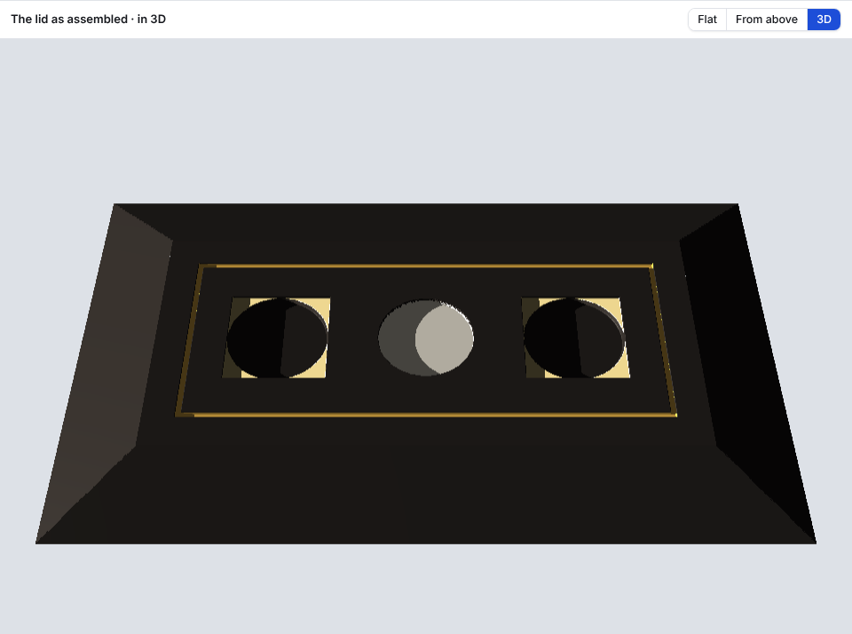
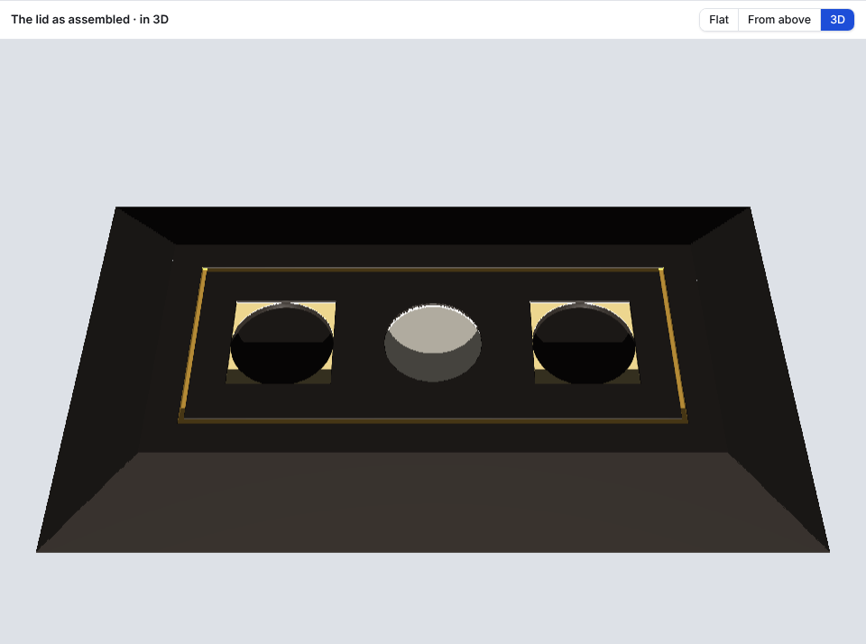
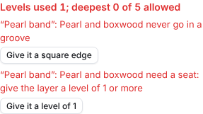

# Ornament side: progress

Newest first. Older reports move to ornament/design/PROGRESS_ARCHIVE.md.

## Card 5: the 3D view (17 Oct 2026)

Card: ornament/design/CARD_05_3d_view.md.

The lid in both pictures: a gold border on a V edge at 1, the centre in white gold at 2, boxwood rectangles at 1 with their mirrored twins, and ebony ellipses on a V edge at 3 inside them. The light is 8° high.

### Results
- Both unit tests the card asks for pass: a field with layers at 1 and 2 is lowered 1 and 2 where it should be and left at the top elsewhere (three points); hips with data-slope 20.556 sit at 20.556° within 0.1°, all four, their top edges level with the field and against its edges.
- The slowed-CPU check (Chrome, CPU 4× slower, `npm run test:ornament3d`) passes. Dragging a layer about in Flat for a few seconds, with the 3D view following it in the background, held the page up for at most 120 ms at once (limit 250), so the drag stayed smooth. Back in 3D, the lid as dragged was on screen at once. Turning the lid with the mouse while the layer was nudged from the keyboard held it up for at most 128 ms, and the lid caught up with the last nudge at once.
- The lettering's 3D check still passes in Chrome. All the other tests still pass (493 in all).
- Tried in Firefox 136 too: the lid draws in 3D.

### What was built
- **Flat | From above | 3D.** F steps through them. With one template open on its own, it is Flat | 3D, and the place lies flat with its edges at its thickness.
- **The lid as assembled.** The field is level. Each hip falls away from its field edge at its data-slope, meeting its neighbours on the corners. Hips that are still outline-only show as plain sloping faces.
- **Every layer cut at its level.** A square edge is a square wall. A V edge is a wall at the V-bit's angle (the same bit as the lettering's 3D view, 30° now).
- **Finishes in colour.** Ebony a near-black satin, gold, white gold, pearl a soft white, boxwood a pale yellow. Bare wood shows as ebony.
- **One low light.** "Round" swings it all the way round the lid, with Left, Back, Right and Front buttons. "Height" raises or lowers it. It starts from the left, 8° high: low and raking. The light is remembered. Keys: , and . swing it round, - and = lower and raise it. Orbit and zoom as in the lettering's 3D view, with Whole lid, Straight down and Along the front.
- **It follows changes.** Anything changed in the side panel (levels, edges, finishes, zones, undo) shows within a moment. Once 3D has been opened, it keeps up in the background while Flat is shown, so it is ready when you look again.
- **Off the page.** The work is done in the lettering's 3D worker, with a progress bar if it takes a while, and Esc to stop it. After Esc, "Work it out" starts it again.
- Ctrl+K: "see the lid in 3D", light from the left, back, right or front, light low and raking, light higher. The ? list has the new keys. BRIEF.md and PLAN.md record it.

### Small fix
- "Something could not be worked out…" when the Ornament tab was opened within a second of the page loading: the tab wasn't ready until the letters had loaded. It is now ready at once. Tried with the letters held back by 0.3 s and 1.5 s: the old version showed the message, the new one doesn't.

### Faults found and fixed while using it
- At first everything drew black: the view was showing every surface from underneath.
- A hairline of background showed along the hips' corner lines. The places now overlap by a hair.
- The light's buttons marked "Right" when the light was from the left.
- After Esc there was no way to work the lid out again without changing something. The card now offers "Work it out".
- A field on its own had no edges. They are now drawn at its thickness.

### Assumptions (please check)
- **V walls slope on the deeper side** of a layer's outline, as the bit leaves them. A sunk layer's wall is inside its outline; a raised layer's wall (a layer higher than what is under it) flares out beyond it.
- **Bare wood is ebony**, and the walls of a cut take the finish of the layer they belong to.
- **The hip's slope** comes from data-slope; if a template has only data-plan-depth, the slope that gives. With neither: "Export the templates again from Blender to see the lid in 3D", as for From above.
- **The hips have no thickness** in the templates yet, so only their top faces are drawn.
- **The V-bit's angle** is read from the lettering's machine settings (30°); with the machine side switched off it is 30°.
- **Light directions** are as in the lettering's 3D view: 0 from the back, the left at −90, the right at 90, the front at 180.

### Questions for the design chat
- None.

### Not tested
- The slowed-CPU check in Firefox (the card asked for Chrome only).
- On a real graphics chip: this machine draws 3D in software.
- The installed offline copy.

## Card 4a: save fixes (17 Oct 2026)

Card: ornament/design/CARD_04a_save_fixes.md.

### Results
- The three tests the card asks for pass: a lid with layers on the field only saves walnut-box_001.zip holding only walnut-box_001_field.svg; that zip opens back with Open lid… exactly as it was; a pearl V layer and a pearl level-0 layer each show their stop, and each stop's fix cures it.
- The card 2 and card 4 save tests are changed to the new rule (only places with layers). All the other tests still pass (491 in all).
- Tried in the browser: one click gave one file, walnut-box_001.zip, with only the field inside, which opened back onto the lid. The same set unzipped and zipped again on the computer also opened.

### What was built
- **Only places with layers are saved.** If no place has layers, the button is greyed out and nothing is numbered.
- **One zip per set**, `<lid>_<number>.zip`, holding the place files with their usual names. That means one file and one save dialog. The files inside carry the time of the save.
- **Open lid… takes a set's zip.** The places in the zip open as they were saved. The other places come from the lid already open, with no layers, as they were when the set was saved. It also takes the zip picked together with the lid's five templates. A zip on its own with no lid open says so: "A set holds only the places that had layers: open its lid first, or pick the set together with the lid’s templates." A zip from a different lid (another data-lid) is not mixed with the open one. A zip the computer has squeezed (re-zipped) opens too.
- **The two inlay stops**, in the lid add-on's words, show in the readout in red with the layer's name: "Pearl and boxwood never go in a groove", and "Pearl and boxwood need a seat: give the layer a level of 1 or more". Each has a one-click fix, tried before it is offered: "Give it a square edge", and "Give it a level of 1" (or of another level already in use, if 1 would break the 1 mm step rule). The layer is also marked in the drawing, like the other problems.
- PLAN.md (file format and cutting rules) and BRIEF.md record both.

### Faults found and fixed while using it
- The files inside the zip showed no date (1980-00-00) in the computer's zip list. They now carry the time of the save.

### Assumptions (please check)
- **Opening a set onto the open lid** clears layers from the places the set doesn't hold, since they had none when it was saved. Ctrl+Z brings back what was there.
- **The fixes** change the edge or the level, never the finish: choosing ebony instead of pearl is a design decision.

### Questions for the design chat
- None.

### Not tested
- In Firefox (none on this machine): tried in Chromium only. Firefox has read zips this way since version 113. The card asked for no slowed-CPU test.
- With the lid add-on reading the zip: it may need to unzip first.
- The installed offline copy.
