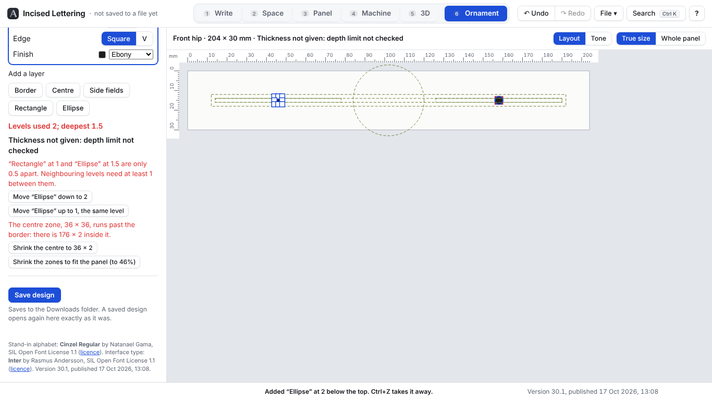
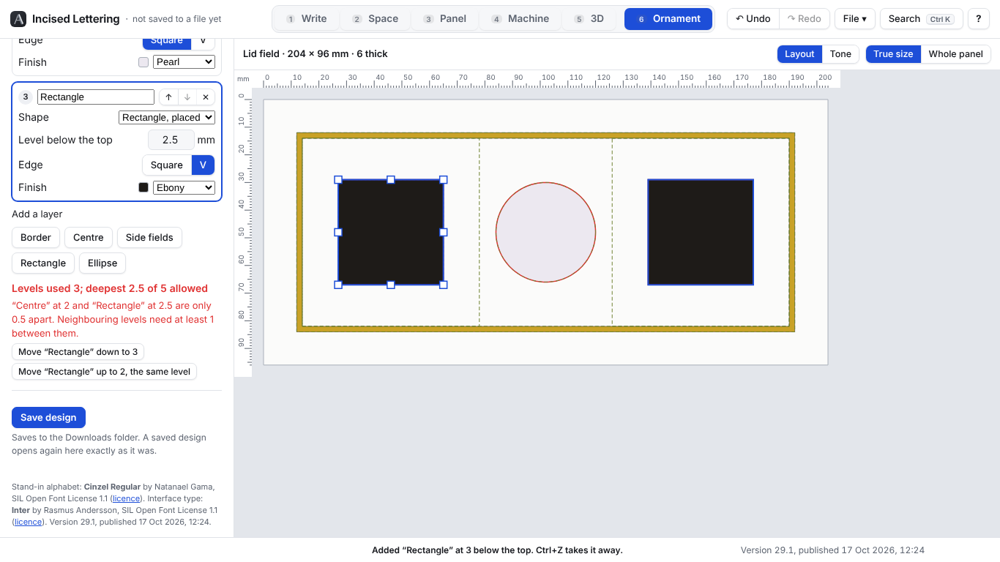

# Ornament side: progress

Newest first. Older reports move to ornament/design/PROGRESS_ARCHIVE.md.

## Card 1a: answers to card 1's questions (17 Oct 2026)

Card: ornament/design/CARD_01a_answers.md.

A hip template with no thickness: the line "Thickness not given: depth limit not checked" shows under the template, in the top bar and under the readout, and the 0.5 step between the two layers is still caught.

### Results
- New test passes: a template without data-thickness opens, shows "Thickness not given: depth limit not checked", and still reports a 0.5 step. A layer 40 deep on it is not reported, since there is no limit to check against.
- All the card 1 tests and the lettering's tests still pass (479 in all).

### What was built or changed
- **No thickness** (point 4): the template's details, the top bar and the levels readout show "Thickness not given: depth limit not checked". The readout then reads "Levels used X; deepest Y", with no "of Z allowed". The 1 mm rules (under 1 deep, and steps under 1) are still checked. This works for shaped hips too, which show the line under their outline.
- **The extra labels** (point 1): already only extra data- attributes; nothing the format names was changed. They are now listed in ornament/PLAN.md under a new heading, "The file format".
- **Curves and side fields** (points 2 and 3): kept as they were, as the answers say, and noted in PLAN.md.

### Faults found
- None new. Using a 204 × 30 hip shows that the stand-in zone sizes (12 from the edge, 36 × 36 centre) don't fit a hip. The readout says so and offers "Shrink the centre…" and "Shrink the zones to fit the panel". The real sizes for hips are Brian's to set, with the outlines card.

### Assumptions
- The line is shown as information, in plain black, not red: it isn't a fault in the design.

### Questions for the design chat
- None.

### Not tested
- In Firefox: there is none on this machine, so this was used in Chromium only.
- With a real hip template from the lid add-on.

## Card 1: the loop, plain shapes (17 Oct 2026)

Card: ornament/design/CARD_01_loop.md.

The sample lid field (204 × 96, 6 thick) at true size: a gold border band at 1, a pearl centre ellipse at 2, and an ebony rectangle at 2.5 with its mirrored twin on the right. The readout has caught the 0.5 step between the centre and the rectangle, in red, with its two fixes.

### Results
- All three tests the card asks for pass: the 204 × 96 template opens at 204 × 96 with its 6 mm thickness; the trapezoid hip gives "Shaped panels come with the outlines card"; a design with three layers saves and opens again with the same layers, levels, edges, finishes and shapes (within 0.01, and the saved file comes out identical the second time); a step of 0.5 and a level deeper than thickness less 1 are each reported.
- The lettering's own tests all still pass (478 in all).

### What was built
- **A sixth tab, Ornament** (key 6), apart from the lettering. It has its own drawing, its own undo (Ctrl+Z inside the tab undoes the ornament only) and its own keys. None of the lettering changes, and nothing in it reads the machine settings, the G-code or the bed.
- **Open template…** (Ctrl+O in the tab) opens an SVG from the lid add-on, or a design saved here. **Try a sample field** opens a plain lid field to try it without Blender. The panel shows at true size with a millimetre ruler across the top and down the side, its place name ("Lid field", "Front hip"…) and its thickness. True size or Whole panel (Shift+Z / Z).
- **Shaped panels** (anything not a rectangle, such as a hip) open showing their outline, with the one plain line "Shaped panels come with the outlines card"; nothing else is offered for them yet.
- **Zones**: border band (Distance from the edge 12, Band width 2), centre (Ellipse or Rectangle, 36 × 36, centred), left and right fields (Gap to the centre 6), "Left mirrors right" on. Drawn as dashed setting-out lines. The sizes are the card's stand-ins.
- **Layers**: each with a name, a shape (Border, Centre, Side fields, or a Rectangle or Ellipse placed and sized with handles), a level below the top, an edge (Square or V) and a finish (Ebony, Gold, White gold, Pearl, Boxwood). Later layers win; ↑ and ↓ (or Alt+↑ / ↓) reorder; ✕ or Delete takes one out. A placed shape is dragged to move it, its eight handles size it, and the arrow keys nudge it 0.1 mm (Shift: 1 mm). A whole drag is one step to undo.
- **The readout**: "Levels used X; deepest Y of Z allowed", Z being the thickness less 1. In red, in plain words: a level under 1 other than 0; neighbouring levels less than 1 apart; deeper than allowed. The layers concerned are outlined in red on the drawing.
- **Fixes**, as CLAUDE.md asks of every problem: each is tried on a copy first and offered only if it cures its problem without making a new one. Too shallow: "Make it 1 deep" / "Bring it to the top (0)". Too close: "Move … down to …" / "Move … up to …, the same level". Too deep: "Raise it to …". I also added two layout problems with fixes: a placed shape off the panel ("Bring it back onto the panel"), and a zone with no room or a centre bigger than the border ("Shrink the centre to …", "Narrow the centre to …", "Shrink the zones to fit the panel").
- **Tone view** (T): the layers in grey, deeper darker, with a key of the levels along the top.
- **Save design** (Ctrl+S in the tab) downloads one SVG in the card's format: the template's own width, height, viewBox, data-place, thickness and outline, then one `<g class="layer">` per layer in order, with closed even-odd paths in absolute mm.
- The tab keeps the design on the laptop, so it is still there after closing the browser. Ctrl+K finds every ornament command and setting; the ? list has an Ornament section.

### Faults found and fixed while using it
- Pressing on a shape started the lettering's own panning underneath instead of moving the shape. The tab now keeps its presses and scrolling to itself.
- Typing a level and then clicking V straight away lost the click. Fixed.
- On a very big panel shown whole, the ruler numbers ran into each other. They now space themselves out at any size.
- On a tiny panel (30 × 30) the 36 × 36 centre ran past the border with nothing said. It is now a problem with its fixes.
- The layer cards ran past the edge of the side panel. Fixed.

### Assumptions (please check)
- **The side fields** are plain rectangles: from the inside of the border band to the gap before the centre, the full height inside the band. They don't wrap round above and below the centre.
- **Left mirrors right**: a placed shape lying wholly to one side of the middle gets a mirrored twin on the other side (dragging either moves both). A layer on either field covers both fields. One that crosses the middle gets no twin.
- **Levels used** counts each different level that has a layer on it, 0 included if a layer is at the top.
- **The 1 apart rule** is checked between cut levels. From the top to the first cut it is the "under 1" rule instead.
- **A new layer** starts 1 deeper than the deepest so far, as far as the board allows.
- **The finish colours** on screen and in the saved file are stand-ins.

### Questions for the design chat
1. **Extra notes in the saved file.** So that a saved design opens again exactly as it was, with its handles, it carries a few extra labels the card doesn't mention: which zone or shape each layer is (`data-shape`, `data-box`), a mark on mirrored twins (`data-twin`), and the zone sizes on `<g id="setting-out">`, which also holds the zone outlines as lines. Everything the card asks for is there exactly as written. Is the lid add-on happy to ignore the rest?
2. **Ellipses are written as straight segments**, 192 to the round, within about 0.003 mm on the lid (0.04 mm on a 600 mm plaque), not as curves. Does the add-on read curves (C commands), or should it stay straight segments?
3. Should the side fields wrap round the centre (see the first assumption)?
4. A hip template with no thickness opens and works, but can't say what depth is allowed. Will the add-on always send data-thickness?

### Not tested
- In Firefox: there is no Firefox on this machine, so all of the above was used in Chromium only. The card asked for no browser-suite run and no slowed-CPU test, so neither was done.
- With a real template from the lid add-on, or a saved design read back into Blender. Both need the add-on's half of the bridge.
- The fixes are tried on a copy every time they are offered, but they have no tests of their own: the card listed only its own tests.
- The installed offline copy.
