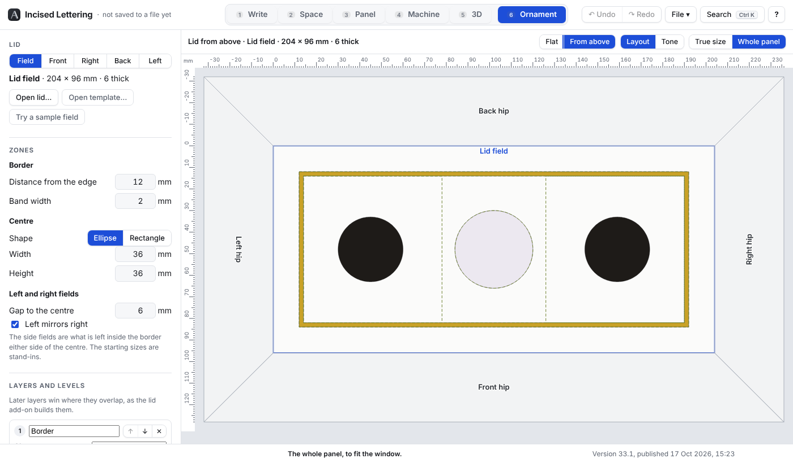
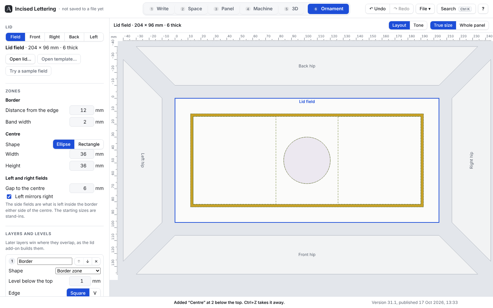

# Ornament side: older progress reports

Moved here from ornament/PROGRESS.md, which keeps the two newest. Newest first.

## Card 4: numbered design sets (17 Oct 2026)

Card: ornament/design/CARD_04_numbered_sets.md.

### Results
- Both tests the card asks for pass: two saves of a lid named walnut-box give walnut-box_001_field.svg … walnut-box_001_hip-left.svg, then the same five with 002; templates without data-lid save as lid_001_field.svg, lid_001_hip-front.svg, lid_001_hip-right.svg, lid_001_hip-back.svg, lid_001_hip-left.svg.
- The card 2 save test now checks the new behaviour: all five places are saved, and the set opens back as the lid exactly as it was. All the other tests still pass (488 in all).
- Tried in the browser with a walnut-box lid: two clicks gave ten files, 001 then 002, and "Last saved: walnut-box 002" beside the button, still there after the page was reloaded.

### What was built
- **Save lid design** now saves the whole lid as one numbered set: `<lid>_<number>_<place>.svg`, every place each time, with layers or without. A place with a design is saved as its design; a hip that is still a shaped panel is saved as its template, as it came.
- **The lid's name** is the templates' data-lid (the field's, if they differ), or "lid" if there is none. Saved designs now carry data-lid on, so a set opened again saves under the same name.
- **The number** is three digits from 001, one up per save, the same for the whole set, counted for each lid separately in this browser.
- **"Last saved: walnut-box 002"** beside the button, for the lid that is open. Nothing shows before its first save.
- The button is ready whenever the whole lid is open, even with no layers yet. Its tip, the Ctrl+K entry and BRIEF.md say what it now does.
- **PLAN.md**, "The file format": the naming added.

### Faults found and fixed while using it
- None.

### Assumptions (please check)
- **Counted per lid.** walnut-box and oak-box each have their own 001, 002…
- **Not undone.** Ctrl+Z doesn't take a set number back: the files are already in the Downloads folder.
- **Odd characters.** A data-lid with spaces or characters a file name can't hold (/ \ : * ? " < > |) has them turned into "-": "walnut box" saves as walnut-box_001_….
- If this browser won't keep anything (a private window that refuses storage), the numbers still go up for that visit, from 001 again next time.

### Questions for the design chat
- None.

### Not tested
- In Firefox (none on this machine): tried in Chromium only. The card asked for no slowed-CPU test.
- With real templates from the lid add-on carrying data-lid.
- The installed offline copy.

## Card 3: the From above view (17 Oct 2026)

Card: ornament/design/CARD_03_from_above.md.

### Results
- Both tests the card asks for pass: hips with data-plan-depth 32 draw 32 deep in From above, against the field edge with no gap, and the corner lines of neighbouring hips meet within 0.01; a lid with one hip without data-plan-depth gives "Export the templates again from Blender to see this view" and is drawn Flat.
- All the other tests still pass (486 in all).

### What was built
- **Flat | From above**, in the bar over the drawing beside Layout and Tone, shown when the whole lid is open. F switches between them; Ctrl+K finds both; the ? list has F.
- **From above** draws the lid as it sits on the box: the field in the middle, each hip squashed across its width to its depth seen from above, against the field edge, neighbouring hips meeting on the diagonal corner lines. Layers and the place names are squashed the same way. Tone works in it, with the same scale as Flat. The bar reads "Lid from above · …".
- **For looking only**: no handles show, and a click on a place goes back to Flat with that place picked.
- **Older hip templates** (no data-plan-depth): asking for From above leaves the drawing Flat, with the line "Export the templates again from Blender to see this view." over it until Flat is picked.
- The choice is remembered in this browser, like Layout and Tone.
- **The hip names** are now dark ink on a pale edge, a little larger and bolder, so they read on the faded hips in light and dark alike. The place being worked on is still named in blue.
- **PLAN.md**, "The file format": data-slope (degrees) and data-plan-depth (mm) added as optional on hip templates. Both are read, and written back in saved designs.

### Faults found and fixed while using it
- The line about older templates first showed only for a moment in the status bar, where the next message wiped it. It now stays over the drawing while From above is asked for.

### Assumptions (please check)
- **Squashed straight across.** Each hip is squashed only across its width (top edge to foot); its length is kept. With a real hip, whose ends run out by its plan depth at each end, that makes the corners meet exactly on the diagonals.
- **All four or none.** If any one hip has no data-plan-depth, the whole lid stays Flat, rather than mixing the two.
- **data-slope** is read and kept, but nothing uses it yet; the depth seen from above comes from data-plan-depth alone.

### Questions for the design chat
- None.

### Not tested
- In Firefox (none on this machine): seen in Chromium only, in light and dark. The card asked for no slowed-CPU test.
- With real templates from the lid add-on: the hips used slope at 40 deg, 32 deep from above (41.77 wide laid flat), tops 204 and 96, feet 268 and 160.
- The installed offline copy.

## Card 2a: hip edges a little long are matching (17 Oct 2026)

Card: ornament/design/CARD_02a_tolerance.md.

### Results
- The new test passes: a front hip 204.2 along its top, against the field's 204 front edge, opens with no note; one 206 along its top shows "The front hip’s top edge is 206 long, but the field edge it meets is 204: it is centred on it. The two files may be from different lids."
- All the other tests still pass (484 in all).

### What was changed
- A hip's top edge within 1 mm of the field edge it meets counts as matching: it is centred on the edge, with no note. The note shows only for a difference of 1 mm or more, longer or shorter. Hips were already centred on their edge, so a 204.2 hip overhangs 0.1 at each end, as in the model.

### Faults found
- None.

### Assumptions
- Exactly 1 mm out shows the note ("1 mm or more").

### Questions for the design chat
- None.

### Not tested
- In Firefox (none on this machine), and with real hip files from the lid add-on.

## Card 2: the whole lid laid out (17 Oct 2026)

Card: ornament/design/CARD_02_lid_layout.md.

The lid opened out flat at true size: the field in the middle (front of the box at the bottom) with a gold border and a pearl centre, the back hip above, the front hip below, the left and right hips at the sides, each 10 clear of the field with its foot outward. The field is the place being worked on (outlined in blue); the hips show their outlines only.

### Results
- All four tests the card asks for pass: five templates open into the layout, each hip's top edge lies along its field edge 10 clear (within 0.01), and the front hip's left end sits under the field's front-left corner; a set with the back hip missing says "Missing: the back hip." and opens nothing (and a doubled file is named too); after a reload the same lid comes back with its layers; Save lid design writes one file per place with layers, and each opens again exactly as it was (the same file, word for word).
- The lettering's tests and card 1's all still pass (483 in all).

### What was built
- **Open lid…** (Ctrl+Shift+O in the tab) takes the five files picked together, templates or saved designs. If one is missing, doubled, unreadable or doesn't say which place it is, it says which, in plain words, and opens nothing.
- **The layout**: all five together at true size, as described in the card. Each hip is turned so its foot faces outward and it reads as seen from outside: seen from the back, its left is the field's right; from the left, its left is the back; from the right, its left is the front. Each place's name is written on it.
- **Click a place** to work on it, or use the row of buttons at the top of the side panel (Field, Front, Right, Back, Left), or [ and ] to step through them. Each place keeps its own zones and layers; the zones, layers, readout and fixes in the side panel are for the place being worked on. Tone view uses one scale for the whole lid, so the same depth is the same grey everywhere. Hips show "Shaped panels come with the outlines card".
- **The pointer readout** names the place under it and gives the position in that place's own millimetres, as its file has them. The rulers measure from the field's back-left corner.
- **Remembered**: the lid, every place's layers and which place was being worked on are kept in this browser. The Ornament tab opens with the lid laid out ready. A design kept by card 1 is still picked up.
- **Opening again** (a lid, a single template or the sample) asks first if any place has layers not yet saved, and names the places. Ctrl+Z still goes back.
- **Save lid design** (Ctrl+Shift+S) downloads field-design.svg, hip-front-design.svg and so on, one for each place that has layers, in the shared format. Save design (Ctrl+S) still saves just the place being worked on.
- Ctrl+K finds all of these, and "work on the front hip" and so on; the ? list has them.

### Faults found and fixed while using it
- The bar over the drawing read "Lid · Lid field". It now reads "Lid field" for the field and "Lid · Front hip" for a hip.

### Assumptions (please check)
- **Hip ends meet at the corners.** At 10 clear, the mitred ends of neighbouring hips come close but don't overlap. Clicking near a corner picks whichever hip the pointer is actually on.
- **A hip whose top edge isn't the same length as its field edge** is centred on that edge, with a plain note: "The front hip's top edge is 200 long, but the field edge it meets is 204: it is centred on it. The two files may be from different lids." There's nothing to fix in this tool; it would come from Blender.
- **The names on the hips** read along each hip. The back hip's name is turned the right way up for reading, not upside down as seen from outside.
- **Save lid design** downloads the files a moment apart. Chrome may ask once to allow several downloads.
- **Try a sample field** and **Open template…** still open one panel on its own, in place of the lid (asking first if there are unsaved layers). The place buttons and Save lid design show only when a whole lid is open.

### Questions for the design chat
- None.

### Not tested
- In Firefox: there is none on this machine, so it was used in Chromium only. The card asked for no slowed-CPU test.
- With real templates from the lid add-on: the hips used were trapezoids 30 deep (top 204 and 96, foot 264 and 156).
- The installed offline copy.

## Card 1a: answers to card 1's questions (17 Oct 2026)

Card: ornament/design/CARD_01a_answers.md.

A hip template with no thickness: the line "Thickness not given: depth limit not checked" shows under the template, in the top bar and under the readout, and the 0.5 step between the two layers is still caught.

### Results
- New test passes: a template without data-thickness opens, shows "Thickness not given: depth limit not checked", and still reports a 0.5 step. A layer 40 deep on it is not reported, since there is no limit to check against.
- All the card 1 tests and the lettering's tests still pass (479 in all).

### What was built or changed
- **No thickness** (point 4): the template's details, the top bar and the levels readout show "Thickness not given: depth limit not checked". The readout then reads "Levels used X; deepest Y", with no "of Z allowed". The 1 mm rules (under 1 deep, and steps under 1) are still checked. This works for shaped hips too, which show the line under their outline.
- **The extra labels** (point 1): already only extra data- attributes; nothing the format names was changed. They are now listed in ornament/PLAN.md under a new heading, "The file format".
- **Curves and side fields** (points 2 and 3): kept as they were, as the answers say, and noted in PLAN.md.

### Faults found
- None new. Using a 204 × 30 hip shows that the stand-in zone sizes (12 from the edge, 36 × 36 centre) don't fit a hip. The readout says so and offers "Shrink the centre…" and "Shrink the zones to fit the panel". The real sizes for hips are Brian's to set, with the outlines card.

### Assumptions
- The line is shown as information, in plain black, not red: it isn't a fault in the design.

### Questions for the design chat
- None.

### Not tested
- In Firefox: there is none on this machine, so this was used in Chromium only.
- With a real hip template from the lid add-on.

## Card 1: the loop, plain shapes (17 Oct 2026)

Card: ornament/design/CARD_01_loop.md.

The sample lid field (204 × 96, 6 thick) at true size: a gold border band at 1, a pearl centre ellipse at 2, and an ebony rectangle at 2.5 with its mirrored twin on the right. The readout has caught the 0.5 step between the centre and the rectangle, in red, with its two fixes.

### Results
- All three tests the card asks for pass: the 204 × 96 template opens at 204 × 96 with its 6 mm thickness; the trapezoid hip gives "Shaped panels come with the outlines card"; a design with three layers saves and opens again with the same layers, levels, edges, finishes and shapes (within 0.01, and the saved file comes out identical the second time); a step of 0.5 and a level deeper than thickness less 1 are each reported.
- The lettering's own tests all still pass (478 in all).

### What was built
- **A sixth tab, Ornament** (key 6), apart from the lettering. It has its own drawing, its own undo (Ctrl+Z inside the tab undoes the ornament only) and its own keys. None of the lettering changes, and nothing in it reads the machine settings, the G-code or the bed.
- **Open template…** (Ctrl+O in the tab) opens an SVG from the lid add-on, or a design saved here. **Try a sample field** opens a plain lid field to try it without Blender. The panel shows at true size with a millimetre ruler across the top and down the side, its place name ("Lid field", "Front hip"…) and its thickness. True size or Whole panel (Shift+Z / Z).
- **Shaped panels** (anything not a rectangle, such as a hip) open showing their outline, with the one plain line "Shaped panels come with the outlines card"; nothing else is offered for them yet.
- **Zones**: border band (Distance from the edge 12, Band width 2), centre (Ellipse or Rectangle, 36 × 36, centred), left and right fields (Gap to the centre 6), "Left mirrors right" on. Drawn as dashed setting-out lines. The sizes are the card's stand-ins.
- **Layers**: each with a name, a shape (Border, Centre, Side fields, or a Rectangle or Ellipse placed and sized with handles), a level below the top, an edge (Square or V) and a finish (Ebony, Gold, White gold, Pearl, Boxwood). Later layers win; ↑ and ↓ (or Alt+↑ / ↓) reorder; ✕ or Delete takes one out. A placed shape is dragged to move it, its eight handles size it, and the arrow keys nudge it 0.1 mm (Shift: 1 mm). A whole drag is one step to undo.
- **The readout**: "Levels used X; deepest Y of Z allowed", Z being the thickness less 1. In red, in plain words: a level under 1 other than 0; neighbouring levels less than 1 apart; deeper than allowed. The layers concerned are outlined in red on the drawing.
- **Fixes**, as CLAUDE.md asks of every problem: each is tried on a copy first and offered only if it cures its problem without making a new one. Too shallow: "Make it 1 deep" / "Bring it to the top (0)". Too close: "Move … down to …" / "Move … up to …, the same level". Too deep: "Raise it to …". I also added two layout problems with fixes: a placed shape off the panel ("Bring it back onto the panel"), and a zone with no room or a centre bigger than the border ("Shrink the centre to …", "Narrow the centre to …", "Shrink the zones to fit the panel").
- **Tone view** (T): the layers in grey, deeper darker, with a key of the levels along the top.
- **Save design** (Ctrl+S in the tab) downloads one SVG in the card's format: the template's own width, height, viewBox, data-place, thickness and outline, then one `<g class="layer">` per layer in order, with closed even-odd paths in absolute mm.
- The tab keeps the design on the laptop, so it is still there after closing the browser. Ctrl+K finds every ornament command and setting; the ? list has an Ornament section.

### Faults found and fixed while using it
- Pressing on a shape started the lettering's own panning underneath instead of moving the shape. The tab now keeps its presses and scrolling to itself.
- Typing a level and then clicking V straight away lost the click. Fixed.
- On a very big panel shown whole, the ruler numbers ran into each other. They now space themselves out at any size.
- On a tiny panel (30 × 30) the 36 × 36 centre ran past the border with nothing said. It is now a problem with its fixes.
- The layer cards ran past the edge of the side panel. Fixed.

### Assumptions (please check)
- **The side fields** are plain rectangles: from the inside of the border band to the gap before the centre, the full height inside the band. They don't wrap round above and below the centre.
- **Left mirrors right**: a placed shape lying wholly to one side of the middle gets a mirrored twin on the other side (dragging either moves both). A layer on either field covers both fields. One that crosses the middle gets no twin.
- **Levels used** counts each different level that has a layer on it, 0 included if a layer is at the top.
- **The 1 apart rule** is checked between cut levels. From the top to the first cut it is the "under 1" rule instead.
- **A new layer** starts 1 deeper than the deepest so far, as far as the board allows.
- **The finish colours** on screen and in the saved file are stand-ins.

### Questions for the design chat
1. **Extra notes in the saved file.** So that a saved design opens again exactly as it was, with its handles, it carries a few extra labels the card doesn't mention: which zone or shape each layer is (`data-shape`, `data-box`), a mark on mirrored twins (`data-twin`), and the zone sizes on `<g id="setting-out">`, which also holds the zone outlines as lines. Everything the card asks for is there exactly as written. Is the lid add-on happy to ignore the rest?
2. **Ellipses are written as straight segments**, 192 to the round, within about 0.003 mm on the lid (0.04 mm on a 600 mm plaque), not as curves. Does the add-on read curves (C commands), or should it stay straight segments?
3. Should the side fields wrap round the centre (see the first assumption)?
4. A hip template with no thickness opens and works, but can't say what depth is allowed. Will the add-on always send data-thickness?

### Not tested
- In Firefox: there is no Firefox on this machine, so all of the above was used in Chromium only. The card asked for no browser-suite run and no slowed-CPU test, so neither was done.
- With a real template from the lid add-on, or a saved design read back into Blender. Both need the add-on's half of the bridge.
- The fixes are tried on a copy every time they are offered, but they have no tests of their own: the card listed only its own tests.
- The installed offline copy.
